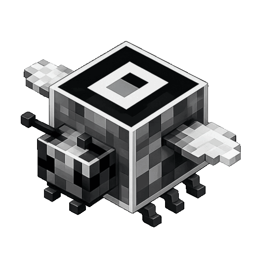
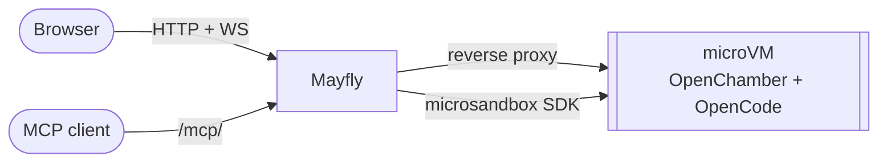

<div align="center">
  
  <h1>Mayfly</h1>
  <p><em>Disposable OpenChamber coding sessions in microVMs.</em></p>
  <p>
    <a href="https://github.com/Th3R3alDuk3/Mayfly/actions/workflows/app.yml"></a>
    <a href="https://github.com/Th3R3alDuk3/Mayfly/tags"></a>
    <a href="pyproject.toml"></a>
    <a href="LICENSE"></a>
  </p>
</div>

Every session boots its own microVM running [OpenChamber](https://github.com/openchamber/openchamber)
on [OpenCode](https://github.com/anomalyco/opencode), hands out a link and a password, and destroys
the VM once the browser tab is closed. Built on [microsandbox](https://github.com/superradcompany/microsandbox).

## 🛠️ How It Works



- `GET /` returns this browser's session as JSON, starting one if none is open. `POST /sessions` and the
  `create_mayfly_session` MCP tool always start a new one. All return `url` and `password`.
- Opening the link sets a session cookie and serves OpenChamber; from then on the origin is reverse-proxied into the VM.
- OpenChamber asks for the password. Its file tree accepts drag-and-drop uploads, so files go straight into the workspace.
- A session with no open browser connection for `SANDBOX_IDLE_TIMEOUT` seconds is destroyed; `SANDBOX_MAX_DURATION` caps its lifetime.

## 🚀 Setup

Requires a Linux host with **KVM** and Docker.

Turn nested virtualization off on the host (`kvm_amd` on AMD). With it on,
every session gets a working `/dev/kvm` of its own and reaches the host's
nested-virtualization code:

```bash
echo "options kvm_intel nested=0" | sudo tee /etc/modprobe.d/kvm-nested.conf
sudo modprobe -r kvm_intel && sudo modprobe kvm_intel
```

1. Build the sandbox image and the server image:

   ```bash
   docker build -f docker/Dockerfile.sandbox -t mayfly-sandbox .
   docker build -f docker/Dockerfile.app -t mayfly .
   ```

   The sandbox image starts from `node:24-trixie-slim` and adds Debian's Python 3.13, git,
   ripgrep, fd, curl and, from PyPI, uv and ruff. OpenCode and OpenChamber come from npm,
   pinned in [Dockerfile.sandbox](docker/Dockerfile.sandbox); pass `OPENCODE_VERSION` and
   `OPENCHAMBER_VERSION` as build arguments to change them.

2. Configure:

   ```bash
   cp .env.example .env
   cp sandbox/opencode.example.json sandbox/opencode.json
   ```

   - `PUBLIC_URL`: URL clients reach this server at; used in session links.
   - `SANDBOX_INDEX_URL`, `SANDBOX_NPM_REGISTRY`: where `pip`, `uv` and `npm` inside a session
     install from, by default PyPI and npmjs; see [Private package index](#private-package-index).
   - `SANDBOX_ALLOW`: everything else a sandbox may reach. `host:PORT` is a service on this
     machine (`host.microsandbox.internal` inside the VM), anything else `DOMAIN[:PORT]`
     or `*.DOMAIN[:PORT]` for its subdomains. Keep the model endpoint in it; the rest of
     the network is denied. `github.com` needs `*.github.com,*.githubusercontent.com` too,
     or clone and raw downloads fail.
   - `SANDBOX_UPLOAD_EXTENSIONS`, `SANDBOX_UPLOAD_MAX_BYTES`: what the browser may drop into
     the file tree. Mayfly rejects other extensions before the upload reaches the VM.
   - `sandbox/opencode.json` (copied from [the example](sandbox/opencode.example.json)): the
     [OpenCode config](https://opencode.ai/docs/config/) every session starts with — model provider,
     API key, permissions. It holds a secret, so like `.env` it stays out of the repository.
   - [sandbox/openchamber.json](sandbox/openchamber.json): OpenChamber's UI settings, mostly the
     offline switches listed under Security.
   - Both are picked up by the next session; `sandbox/` is mounted read-only into the VM at
     `/etc/mayfly`, so `instructions` can reference [sandbox/AGENTS.md](sandbox/AGENTS.md).

3. Start the server and load the sandbox image into it. The container needs
   the KVM device, a volume so loaded images survive restarts, and the
   `sandbox/` directory:

   ```bash
   docker run -d -p 127.0.0.1:8123:8123 \
     --restart unless-stopped \
     --device /dev/kvm \
     -v mayfly-data:/root/.microsandbox \
     -v "$PWD/sandbox:/app/sandbox:ro" \
     --env-file .env \
     --name mayfly \
     mayfly
   docker save mayfly-sandbox \
     | docker exec -i mayfly uv run --no-sync msb load
   ```

4. Open <http://localhost:8123> for a session, or connect an MCP client to
   `http://localhost:8123/mcp/` (with the trailing slash).

Neither endpoint has authentication; put Mayfly behind trusted network controls.

### Without Docker

For testing, the server runs directly with [uv](https://docs.astral.sh/uv/).
Its user must be able to read and write `/dev/kvm`; `uv run msb doctor` checks
that. The sandbox image is still built with Docker as above.

```bash
uv sync
docker save mayfly-sandbox | uv run msb load
uv run python main.py
```

### Private package index

Sessions install from `SANDBOX_INDEX_URL` (`pip`, `uv`) and
`SANDBOX_NPM_REGISTRY` (`npm`). A proxy such as Nexus fits, by name or by IP
address; if it uses an own certificate, name it in `SANDBOX_INSECURE_HOST`.

The sandbox image's own packages come from the indexes it is built with, by
default PyPI and npmjs as well. Build it against others with the matching
build arguments; they affect the build only, sessions keep using the `.env`
settings above:

```bash
docker build -f docker/Dockerfile.sandbox \
  --build-arg PIP_INDEX_URL=https://nexus.example.com/repository/pypi/simple \
  --build-arg PIP_TRUSTED_HOST=nexus.example.com \
  --build-arg NPM_CONFIG_REGISTRY=https://nexus.example.com/repository/npm/ \
  --build-arg NPM_CONFIG_STRICT_SSL=false \
  -t mayfly-sandbox .
```

The server image takes it from the `[tool.uv]` block in
[pyproject.toml](pyproject.toml): set `index` to the private index and, for
plain HTTP, add its host to `allow-insecure-host`. `uv lock` then keeps the
locked versions and rewrites their URLs in `uv.lock`, and the build installs
from there. Both files then differ from the repository; keep those changes
local. The `FROM` images of both Dockerfiles must be reachable as well.

### Prebuilt images

CI publishes both images to ghcr.io:

- `ghcr.io/th3r3alduk3/mayfly:latest` replaces the local server build.
- `ghcr.io/th3r3alduk3/mayfly-sandbox:latest` goes into `SANDBOX_IMAGE`.
  It is rebuilt monthly; `msb pull --force` fetches the update.

The server pulls a missing `SANDBOX_IMAGE` when the first session starts, which
can outlast the client's timeout, so pull it beforehand:

```bash
docker exec mayfly uv run --no-sync msb pull \
  ghcr.io/th3r3alduk3/mayfly-sandbox:latest
```

`SANDBOX_IMAGE` accepts any OCI reference. Registry credentials, plain-HTTP
registries and custom CAs go into `~/.microsandbox/config.json`, which lives
in the `mayfly-data` volume when the server runs in Docker.

## 🛡️ Security

- **Isolation:** every session is its own microVM with its own kernel (KVM via libkrun) and the
  restricted in-guest security profile, fixed RAM/vCPU caps and a disposable disk.
- **Network:** denied by default; only the package indexes, PyPI's file host and the
  `SANDBOX_ALLOW` destinations are reachable, and only those names resolve. LAN addresses are
  allowed, so a private index or model endpoint works. No VM can see another one or the host
  beyond the listed ports.
- **Offline UI:** [sandbox/openchamber.json](sandbox/openchamber.json) turns off everything in
  OpenChamber that reaches the internet, outlives the VM or spends extra model calls — the agent's
  browser, app-control and memory tools, the skill catalog, dictation, usage reporting and the
  goal/recap/suggestion helpers; the update check is pointed at a dead address in the image.
  OpenCode's `webfetch`/`websearch` are denied in `sandbox/opencode.json`, its auto-update, share,
  LSP download and model fetch by environment. Flip an `agent*Enabled` key to get a tool back.
- **Access:** a session is reachable only through its unguessable link, then guarded by
  OpenChamber's password. The VM's port is bound to the server's loopback.
- **Errors:** responses and tool errors never carry exception text, so no hosts or stack
  traces leak to the browser or the chat.
- **Host access:** the server needs `/dev/kvm` only.

## 🧩 Layout

- [`main.py`](main.py) - FastAPI app, MCP mount, lifespan
- [`config.py`](config.py) - settings, read from `.env`
- [`models/session.py`](models/session.py) - the `url`/`password` schema
- [`routes/session.py`](routes/session.py) - session API and cookie hand-off
- [`routes/_proxy.py`](routes/_proxy.py) - HTTP and WebSocket reverse proxy into the VM
- [`services/sandbox.py`](services/sandbox.py) - microVM boot and teardown
- [`services/session.py`](services/session.py) - session registry and idle reaper
- [`tools/`](tools/) - MCP tools
- [`sandbox/`](sandbox/) - what every session starts with
- [`docker/`](docker/) - server and sandbox images
